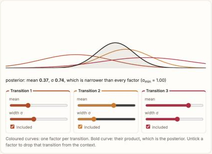

# PEARL From Scratch

PEARL (Rakelly, Zhou, Quillen, Finn & Levine, ICML 2019), the off-policy meta-RL method that explores by sampling from a learned belief over tasks. Rebuilt here in plain PyTorch with no RL libraries, with an interactive explainer and a live in-browser demo.

*Each transition casts a Gaussian vote on what the task is, and the belief is their product. That is why more evidence can only narrow it. This figure is interactive on the site.*

**Results:** the experiment suite (3 task families, the paper's ablations, 3 seeds) is still running. Charts and numbers appear on the site and in `results/RESULTS.md` when it finishes.

- **Site:** [amalmehta.com/PEARL](https://amalmehta.com/PEARL/): writeup, demo, results
- [Instructions](docs/INSTRUCTIONS.md): setup, tests, training, reproducing every figure
- [System design](docs/SYSTEM-DESIGN.md): architecture, deviations from the authors' code, run budget, limits
- [File structure](docs/FILE-STRUCTURE.md) · [Manual review](docs/MANUAL-REVIEW.md) · [Viz log](docs/VIZ-LOG.md) · [Prompt log](docs/PROMPTS.md)
- Paper: [arXiv 1903.08254](https://arxiv.org/abs/1903.08254) · Authors' code: [katerakelly/oyster](https://github.com/katerakelly/oyster)

## How it was built

How this was built and how it works, with diagrams: [docs/HOW-IT-WAS-BUILT.md](docs/HOW-IT-WAS-BUILT.md)
