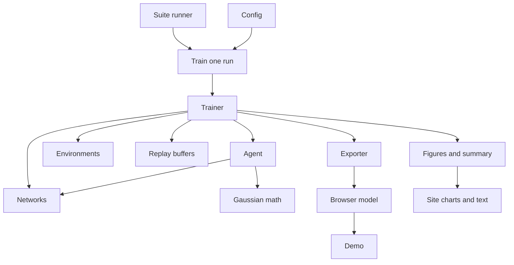
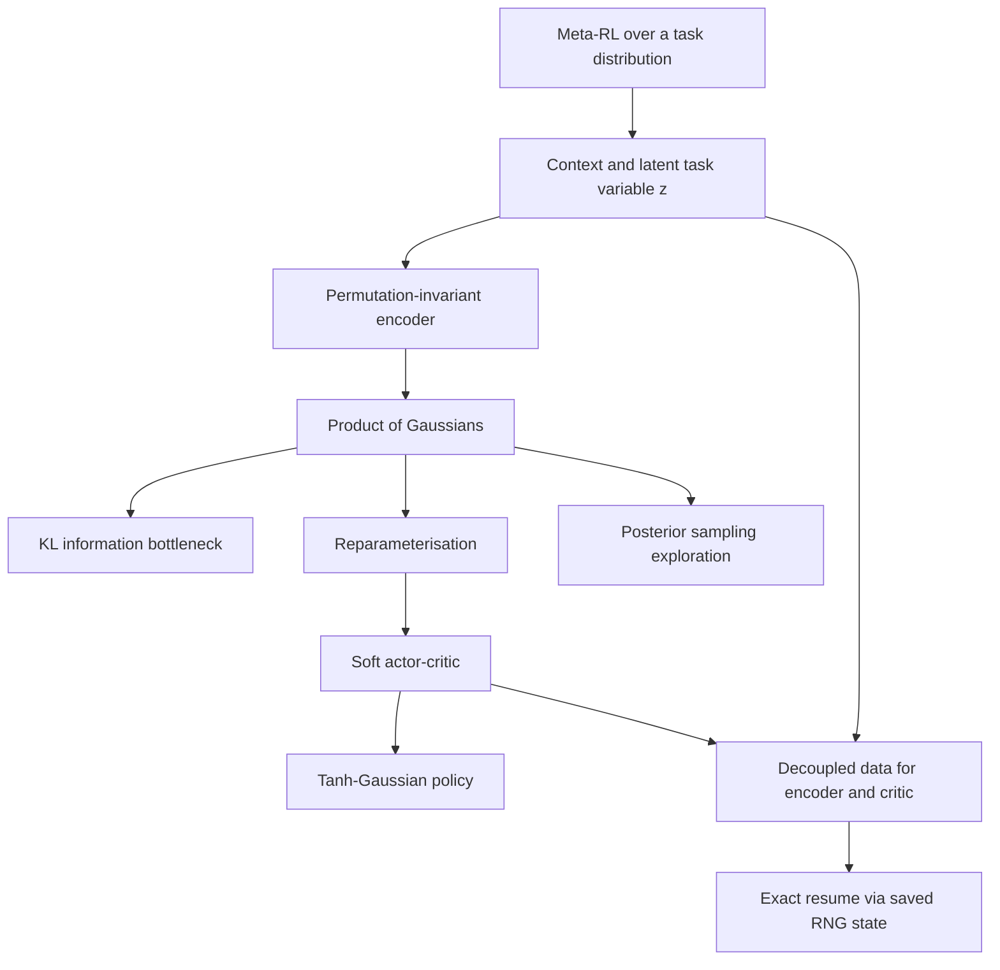

<!-- ProjectForge explainer at 1925369 -->
# How PEARL was built

This repo rebuilds PEARL from scratch in PyTorch, with no RL libraries. PEARL is a meta-reinforcement-learning method: one agent learns to solve a new task after only a few tries. The repo also has experiments on three cheap 2D task families, a static article site, and an in-browser demo. It is for the author to learn the method deeply, and for readers who want a working, readable baseline. The one idea that makes it work: a network turns each experienced transition into a small Gaussian guess about which task this is. Multiplying those guesses gives a belief that narrows as evidence comes in. The policy acts on a sample from that belief, so it explores while unsure and commits once it knows.

## Build history

```mermaid
flowchart LR
  idea["Idea: recreate PEARL from scratch with writeup, demo, experiments"]
  d1["Decisions: PEARL meta-RL, PyTorch + Gymnasium only, laptop compute"]
  d2["Decisions: several cheap 2D families, paper's ablations, 3 seeds"]
  m1["Core algorithm, envs, tests 2026-10-20"]
  m2["Experiment runner and figures 2026-10-20"]
  d3["Decisions: static site + in-browser demo, Distill margin-notes layout"]
  m3["Site, demo, CI, docs 2026-10-20"]
  m4["KaTeX equations 2026-10-21"]
  m5["Spec brought up to the meta doc 2026-11-09 to 2026-11-19"]
  d4["Decisions: free up the Mac, add resume, keep wind at 0.08, go public as is"]
  m6["Resume, honest empty states, README, real site link 2026-11-19"]
  idea --> d1 --> d2 --> m1 --> m2 --> d3 --> m3 --> m4 --> m5 --> d4 --> m6
```

- **Core algorithm, envs, tests (2026-10-20):** Added scaffolding (pyproject, Makefile, gitignore), then the PEARL agent, the environments, the training loop and unit tests. This followed the choices of PEARL meta-RL, PyTorch with no RL libraries, and 2D Point-Robot families.
- **Experiment runner and figures (2026-10-20):** Added the scripts that run the suite of the paper's ablations and draw the figures, sized for a laptop with 3 seeds.
- **Site, demo, CI, docs (2026-10-20):** Added the static site with the in-browser demo and exported agents, CI for tests and GitHub Pages, and the project brief and design docs. The author picked a Distill-style article with margin notes.
- **KaTeX equations (2026-10-21):** Typeset the site's equations with KaTeX and split the long ones into cleaner cards.
- **Spec updates (2026-11-09 to 2026-11-19):** Three commits brought the spec up to the current meta doc and added the shared shortcuts.
- **Resume and honesty pass (2026-11-19):** The suite never finished. 8 of 24 runs stopped around iteration 47 of 150, so the author chose to add resume and run the full suite. The site now shows honest empty states, the repo got a README, and the site is linked at its real address. The Point-Wind range stayed at ±0.08 and the spec was fixed to match.

## Code map

The trainer writes `metrics.json` per run, which the figures script reads. It also writes `agent.pt`, which the exporter reads.

| Part | File | What it does |
|---|---|---|
| Config | `pearl/config.py` | Paper hyperparameters, laptop-budget overrides and the six ablation variants, merged by `make_config`. |
| Train one run | `pearl/train.py` | Command line: builds a config and calls `PEARL(...).train()`. |
| Suite runner | `experiments/run_all.py` | Runs 8 env/variant pairs × 3 seeds as subprocesses, skips finished runs, reports status. |
| Trainer | `pearl/trainer.py` | Data collection, the SAC + encoder update, meta-test evaluation, checkpoint and resume. |
| Agent | `pearl/agent.py` | Encoder q(z\|c) plus policy π(a\|s,z): prior, infer, sample z, KL, act. |
| Networks | `pearl/networks.py` | MLP with rlkit-style init, tanh-Gaussian policy, MLP and LSTM context encoders. |
| Gaussian math | `pearl/gaussian.py` | Product of diagonal Gaussians and KL to a standard normal. |
| Environments | `pearl/envs.py` | Point-Robot, Sparse Point-Robot and the invented Point-Wind. |
| Replay buffers | `pearl/buffers.py` | One ring buffer per task, with random batches, whole-trajectory sequences and save/load. |
| Figures and summary | `experiments/make_figures.py` | Aggregates runs into `results/summary.json`, `RESULTS.md` and three PNG figures, with random and oracle reference lines. |
| Exporter | `pearl/export.py` | Writes policy and encoder weights as base64 float32, plus sample paths and provenance, to JSON. |
| Browser model | `site/js/model.js` | Plain-JS forward passes, running product of Gaussians, and the three envs. |
| Demo | `site/js/demo.js` | Animated meta-test episode on a canvas; click to set a goal or wind. |
| Site charts and text | `site/js/figures.js`, `site/js/text.js` | Draw charts and result sentences from `data/summary.json`, or a "not run yet" note if it is missing. |

Supporting files: `tests/test_core.py` holds the unit tests. `.github/workflows/pages.yml` publishes `site/` to GitHub Pages when it changes. The `Makefile` has the `setup`, `test`, `experiments`, `status`, `figures`, `export` and `site` targets.

## Concepts

**Meta-RL over a task distribution.** Training runs on many related tasks. Here a task is a goal position or a wind vector. Testing uses held-out tasks from the same family, and the agent must adapt within one episode of a few trajectories, with no gradient steps. The repo has 100 tasks per family: tasks 0–79 are for training and 80–99 are held out. In `pearl/envs.py`, Point-Robot and Sparse Point-Robot rebuild the original "oyster" code's task lists from seed 1337, so task i here matches task i there. Point-Wind is not in the paper: the goal is fixed at the origin and each task adds a constant wind w ~ U[-0.08, 0.08]² to every step. Where: `pearl/envs.py`, `pearl/trainer.py` (`train_tasks`, `eval_tasks`).

**Context and latent task variable z.** The context c is a set of transitions (s, a, r), plus s′ when dynamics vary. An encoder compresses the context into a 5-dimensional vector z, the agent's estimate of which task it is in. The policy, the Q-functions and the value function all take z as an extra input. Point-Wind turns on `use_next_obs_in_context`, because wind shows up only in how the state changes. The sparse task gives the encoder sparse rewards and the RL batch dense rewards, as oyster does. Where: `pearl/trainer.py` (`_context_features`, `context_dim`), `pearl/envs.py`.

**Permutation-invariant encoder.** The default encoder is an MLP applied to each transition on its own. Each output is one Gaussian factor Ψ(z | cₙ). Shuffling the context does not change the result. The paper's ablation swaps this for an LSTM, a recurrent network that reads the context in order. It is fed either shuffled transitions or whole trajectories (`random_sequence`). Where: `pearl/networks.py` (`MlpEncoder`, `RecurrentEncoder`), `pearl/buffers.py` (`random_sequence`), `pearl/config.py` (`VARIANTS`).

**Product of Gaussians.** The posterior is the product of the per-transition factors. A product of Gaussians is again Gaussian. Precisions (inverse variances) add, and the mean is precision-weighted:

$$\frac{1}{\sigma^2} = \sum_{n} \frac{1}{\sigma_n^2}, \qquad \mu = \sigma^2 \sum_{n} \frac{\mu_n}{\sigma_n^2}$$

So every transition can only narrow the belief. Variances come from a softplus of the raw output and are clamped at 1e-7. The browser keeps a running version: it adds 1/v and μ/v as each step arrives. Tests check the closed form against brute-force density multiplication, check permutation invariance, and check that the belief narrows. Where: `pearl/gaussian.py` (`product_of_gaussians`), `pearl/agent.py` (`infer`), `site/js/model.js` (`Posterior`), `tests/test_core.py`.

**KL information bottleneck.** A KL penalty pulls the posterior toward the prior N(0, I). z then carries only the task information that helps the critic. The trainer adds λ·KL to the encoder's gradient, with λ = 0.1 for dense tasks and 1.0 for sparse:

$$\mathrm{KL}\big(\mathcal N(\mu,\sigma^2)\,\|\,\mathcal N(0,I)\big) = \tfrac12 \sum_i \big(\sigma_i^2 + \mu_i^2 - 1 - \log \sigma_i^2\big)$$

The "deterministic" ablation turns this off. It averages per-transition embeddings into a point z, with no variance. Where: `pearl/gaussian.py` (`kl_to_standard_normal`), `pearl/agent.py`, `pearl/trainer.py` (`train_step`), `pearl/config.py`.

**Reparameterisation.** z is drawn as z = μ + σ·ε with ε ~ N(0, I). Because of this, the gradient of a loss on z flows back into μ and σ, and from there into the encoder. Where: `pearl/agent.py` (`sample_z`).

**Soft actor-critic (SAC).** SAC is an off-policy actor-critic method that maximises reward plus policy entropy. It learns from replayed data, not only fresh data. This version follows oyster: two Q-networks, a value network V, and a slowly tracking target V (τ = 0.005). The losses are:

$$Q_{\text{target}} = r\cdot\text{scale} + (1-d)\,\gamma\,\bar V(s', z), \quad L_V = \big(V(s,z) - [\min_j Q_j(s,\tilde a,z) - \log\pi(\tilde a|s,z)]\big)^2, \quad L_\pi = \log\pi(\tilde a|s,z) - \min_j Q_j(s,\tilde a,z)$$

Small L2 penalties on the policy's mean and log-std are added. The hard part is who trains the encoder. z goes into Q undetached, but into the policy and V detached. So the encoder learns only from the Bellman (Q) error and the KL term. A test asserts that policy gradients never reach the encoder. Where: `pearl/trainer.py` (`train_step`), `tests/test_core.py` (`test_encoder_gets_gradient_from_critic_not_policy`).

**Tanh-Gaussian policy.** The policy samples from a Gaussian and squashes the sample with tanh, so actions land in [-1, 1]. The env then scales them by 0.1. The log-probability needs a change-of-variables correction: log π(a) = log N(u; μ, σ) − Σ log(1 − tanh²u + 1e-6). Log-std is clamped to [-20, 2]. At evaluation the action is tanh(mean). Where: `pearl/networks.py` (`TanhGaussianPolicy`), `pearl/envs.py` (`ACTION_SCALE`).

**Posterior sampling exploration.** At meta-test the agent samples z from its current belief and holds it for a whole trajectory. With the prior, different samples send it toward different guessed tasks; that is the exploration. After `num_exp_traj_eval` trajectories (1 for dense, 5 for sparse), it refits the belief on all context gathered so far after every trajectory. The belief narrows and behaviour settles. The demo draws "ghost" paths from other samples of the current belief to show this. Where: `pearl/trainer.py` (`evaluate`, `collect_data`), `site/js/demo.js` (`endTraj`, `imagine`).

**Decoupled data for encoder and critic.** Two buffers exist per task. `replay` holds everything and feeds the SAC batch. `enc_replay` is cleared each time a task is revisited, so the encoder sees only recent data, close to what it will see at test time. Two ablations test this choice: context drawn from the whole buffer (`offpolicy`), or context equal to the RL batch (`rlbatch`). Where: `pearl/trainer.py` (`__init__`, `sample_context`, `train`), `pearl/buffers.py`, `pearl/config.py`.

**Exact resume via saved RNG state.** After every iteration the trainer saves all five networks, all five optimisers, both buffers (filled rows only), and the numpy, env and torch random-generator states to `state.pt`. It writes a temp file first and then renames it, so a kill mid-save cannot corrupt the checkpoint. A resumed run produces the same losses and eval curve as one that never stopped, and a test checks this. A checkpoint from a different config or seed is ignored. Where: `pearl/trainer.py` (`_save_state`, `_load_state`), `pearl/buffers.py` (`state`, `load_state`), `tests/test_core.py` (`test_resumed_run_matches_uninterrupted_run`).

## One input, start to finish

Input: `python -m pearl.train --env sparse_point --variant pearl --seed 0 --out runs/sparse_point/pearl/seed0`, which is one job that `experiments/run_all.py` `launch` starts.

1. **Build the config.** `pearl/train.py` `main` parses the arguments, sets torch to 2 threads and calls `make_config` in `pearl/config.py`. The config is `PAPER_DEFAULT`, then the sparse-point-robot settings, then `BUDGET`. Result: 20-step trajectories, γ = 0.90, reward scale 100, KL λ = 1.0, 10 tasks sampled per iteration, 100 prior steps and 900 posterior steps per task. It also sets 150 iterations of 250 gradient steps, 8 tasks × 128 transitions per step, 128-unit networks, and a context of 256 transitions.
2. **Set up.** `PEARL.__init__` in `pearl/trainer.py` calls `make_env` to build `SparsePointRobot` from `pearl/envs.py`. Its goals are 100 points on the unit half circle, shuffled with seed 1337. The context is 5 numbers per transition: obs 2, action 2, reward 1, with no next obs. The trainer builds `PEARLAgent` (`pearl/agent.py`), the twin Q, V and target V `MLP`s (`pearl/networks.py`), the Adam optimisers, and two `MultiTaskBuffer`s (`pearl/buffers.py`).
3. **Check for a stopped run.** `train` calls `_load_state`. If no `state.pt` exists, it seeds every training task with 200 steps through `collect_data` at an update rate of `np.inf`, so z always comes from the prior.
4. **Collect.** In each iteration, for 10 random training tasks: `enc_replay[task].clear()`, then `collect_data` with 100 prior steps, then 900 more steps. In those, `agent.infer(sample_context([task]))` refits the belief after every trajectory. Each trajectory comes from `rollout`. It calls `agent.act` and then `SparsePointRobot.step`, which returns the dense reward −distance and puts the sparse reward in `info` (1 − distance inside radius 0.2, otherwise 0).
5. **Update, 250 times.** `train_step` picks 8 tasks. `sample_sac` draws 128 dense-reward transitions per task from `replay`. `sample_context` draws 256 transitions per task from `enc_replay`, with sparse rewards. `agent.infer` runs the MLP encoder to get (8, 256, 10), takes the softplus of the variance half, and calls `product_of_gaussians` to get μ and σ² of shape (8, 5). `sample_z` reparameterises. Then: the KL backward pass, the Q loss backward pass with a step for Q1, Q2 and the encoder, the V loss and its step, the soft update of the target V, and the policy loss and its step.
6. **Evaluate every 5 iterations.** `evaluate` runs each of the 20 held-out tasks for ⌈400/20⌉ = 20 deterministic trajectories. The first 5 use z from the prior. From the 5th on, `agent.infer` refits on all transitions gathered so far, and z is resampled from the belief for each trajectory. The per-trajectory sparse returns become `eval_curve`; the last one is `eval_final`.
7. **Save.** `_save` writes `metrics.json` and `agent.pt`, and `_save_state` writes `state.pt` atomically. If the process is killed, rerunning the same command resumes at the next iteration.
8. **Aggregate.** `experiments/make_figures.py` `main` loads every `metrics.json`. It computes the mean ± std across seeds and the random-action and oracle reference returns (`random_policy_return`, `oracle_return`). It writes `results/summary.json`, `results/RESULTS.md` and `figures/*.png`.
9. **Export.** `make export` runs `pearl/export.py` `export` on seed 0. It reloads the agent and records 4 sample episodes. It writes the weights as base64 little-endian float32, plus provenance (iterations done, env steps, last return), to `site/data/sparse_point.json`. It copies the summary to `site/data/summary.json`.
10. **Run in the browser.** `site/js/demo.js` `load` fetches that JSON and builds `Agent`, `Env` and `Posterior` from `site/js/model.js`. Each `stepOnce` calls `Agent.act` (ReLU layers, then tanh of the mean), then `Env.step`, then `Posterior.add(Agent.factor(feat))`. `endTraj` switches to the posterior after `num_exp_traj_eval` trajectories. `tests/test_core.py` `test_browser_model_matches_torch` checks that these JS forward passes match PyTorch to within 1e-5. `site/js/figures.js` draws the charts from `data/summary.json`. If that file is missing, as it is in the current repo, it shows a "not run yet" note instead.

## Where this came from

Written from the spec, the author's decisions, the git history and the code as of commit 1925369 ("Link the site at its real address", 2026-11-19).
